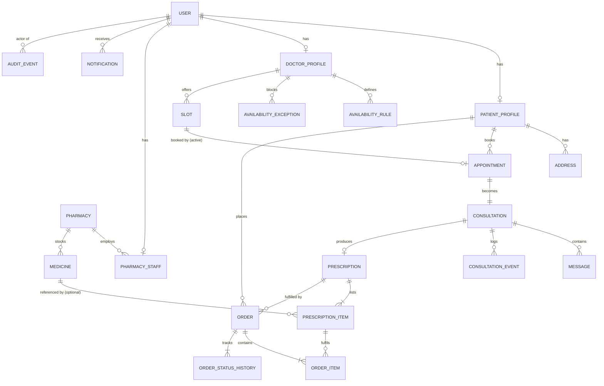

# TeleCare+ — Project Blueprint (Phase 0)

> Status: **APPROVED 2026-09-30** with the decisions below.
> Team: Himanshu Thapa, Tanay Nagar, Vishnu Oberoi. Guide: Dr. Nutan Singh.

## Approved decisions (these override anything below that disagrees)

| #   | Decision                                                                                                                                                                                                                                           |
| --- | -------------------------------------------------------------------------------------------------------------------------------------------------------------------------------------------------------------------------------------------------- |
| D1  | **Stack:** React Native + Expo (mobile), Node.js + TypeScript (backend), PostgreSQL. Business rules stay database-agnostic: they depend on repository interfaces, and only the repository implementations know about PostgreSQL. Modular monolith. |
| D2  | **One mobile app** for Patient, Doctor and Pharmacy Admin, with role-based navigation. No pharmacy web dashboard in the MVP (it can be added later over the same API).                                                                             |
| D3  | **Auth:** phone number + password. **No OTP/SMS in the MVP.** Auth is built behind interfaces so OTP or another method can be added later. The MVP password reset is therefore limited (see §16 note).                                             |
| D4  | **Payments: Cash on Delivery only.** No gateway and no mock "pay now" screen. The `PaymentProvider` boundary remains for the future.                                                                                                               |
| D5  | **Location:** `~/telecare-plus`, a git repository.                                                                                                                                                                                                 |
| D6  | **Patient tabs:** Home · Doctors · Appointments · Medicines · Profile. **Medicines** contains **Prescriptions · Medicine Catalog · Cart · Orders**. Main flow: Consultation → Prescription → Medicines → Order → Tracking.                         |
| D7  | Video provider abstraction kept. Consultation chat stored in our own system.                                                                                                                                                                       |
| D8  | Structured prescription shown inside the consultation chat. It is immutable once issued. The pharmacy uses the structured data.                                                                                                                    |
| D9  | Transactional order creation with stock reservation. The system prevents over-ordering, ordering unavailable stock, invalid transitions and cross-user access. Every order gets a unique tracking ID.                                              |
| D10 | "Real-time tracking" means live status updates with timestamps. No GPS.                                                                                                                                                                            |
| D11 | The patient journey is the primary product and the primary demo. Doctor/pharmacy UI is functional and minimal.                                                                                                                                     |

**Open questions these decisions create (to be settled in the phase where they matter):**

- _Catalog + Cart (Phase 8):_ Medicines marked `requires_prescription` can only enter the cart from an issued prescription, and only up to the remaining quantity it allows. Can medicines that do **not** need a prescription (OTC) be added straight from the catalog? If so, a cart could hold items from several prescriptions plus OTC items, so `order.prescription_id` becomes per-item (`order_item.prescription_item_id`, nullable for OTC). The data model in §11 already stores the link on the order item, so either answer fits.
- _Password reset without OTP (Phase 2):_ Options are (a) change password while logged in plus a reset code that is only visible in dev/admin logs, or (b) defer self-service reset. My recommendation is (a), behind a `ResetCodeDelivery` port so SMS can be plugged in later. **Settled in Phase 2: (a) was built.**

---

## 0. What I inspected first

| Looked at                                                                    | Found                                                                                                                                                                             | What it means for the plan                                                                                                              |
| ---------------------------------------------------------------------------- | --------------------------------------------------------------------------------------------------------------------------------------------------------------------------------- | --------------------------------------------------------------------------------------------------------------------------------------- |
| Existing TeleCare+ code                                                      | **None.** No repository exists yet.                                                                                                                                               | Greenfield. Nothing to migrate or reuse.                                                                                                |
| `Downloads/TeleCare+ – Remote Health & Pharmacy Platform (1).pdf` (synopsis) | Commits to: MERN + React Native, Agora/ZEGOCLOUD video, JWT + bcrypt + RBAC, "prescription inside the consultation chat", "pay securely", "real-time tracking", 12-week PERT plan | The blueprint keeps every promise that is in the synopsis, but some become scoped versions (see §23 Risks, "Synopsis promises vs MVP"). |
| `~/AndroidStudioProjects`                                                    | Several Kotlin/Android projects (e.g. `chess-kotlin-andr`)                                                                                                                        | The team has Android experience. This matters when choosing the mobile technology (§21).                                                |
| Tools on this Mac                                                            | Java 21, Python 3.9, git. **Node.js, Docker and PostgreSQL/MongoDB are not installed.**                                                                                           | Phase 1 has to install the tools first.                                                                                                 |

---

## 1. Product overview

**TeleCare+** is a mobile app for patients in remote and underserved areas. It takes a patient through one connected journey:

```
DISCOVER → BOOK → CONSULT → PRESCRIBE → ORDER → TRACK
```

The core idea is that **one record is passed along the whole chain.** An appointment becomes a consultation. The consultation produces a prescription. The prescription becomes an order. The order has a tracking ID. Because each step points to the step before it, the patient never has to re-enter data or upload a prescription somewhere else. This is the gap the synopsis identified in Practo, eSanjeevani and PharmEasy.

**What TeleCare+ is not:** it does not diagnose, it does not suggest medicines, and it does not replace the doctor's clinical judgement. It connects the patient, the doctor and the pharmacy.

---

## 2. Target users

| Role                  | Who                                                                                                                  | Main need                                                                        | Device / context                                                 | How much UI polish in the MVP  |
| --------------------- | -------------------------------------------------------------------------------------------------------------------- | -------------------------------------------------------------------------------- | ---------------------------------------------------------------- | ------------------------------ |
| **Patient** (primary) | Adult in a village or small town. Often has limited technical literacy. May be booking for a family member (future). | "See a doctor who speaks my language without travelling, then get my medicines." | Low/mid-range Android phone, unstable 3G/4G, limited mobile data | **High.** This is the product. |
| **Doctor**            | Registered practitioner providing remote consultations                                                               | "Handle my schedule, consult, and issue a prescription quickly."                 | Phone or laptop, usually better connectivity                     | Medium. Functional and clean.  |
| **Pharmacy admin**    | Staff at the partner pharmacy                                                                                        | "See incoming orders, check stock, and move orders along."                       | Desktop/laptop browser or tablet                                 | Basic. Functional.             |

Design assumptions for the patient:

- Uses Android (about 95% of the target market in India). iOS works because the stack is cross-platform, but we do not optimise for it.
- May have a small screen and large system font settings. Layouts must handle 1.3× font scaling.
- Uses the app rarely (a few times a year), so every screen has to be understandable without remembering how it worked last time.

---

## 3. User journeys

### 3.1 Primary demo journey (the MVP definition)

```
PATIENT                         DOCTOR                        PHARMACY ADMIN
───────                         ──────                        ──────────────
Register → Login → Home
Find doctor → Filter
View doctor → Pick slot
Book appointment ──────────────▶ Sees it in "Today"
Waiting room (joins early)
                                Starts consultation
◀──────────── Consultation (video + chat) ────────────▶
                                Writes prescription
                                Issues it → completes
Gets "Prescription ready"
Opens prescription
Selects medicines → Reviews
Places order ───────────────────────────────────────────────▶ Sees new order
                                                              Confirms → Packs
                                                              → Ships → Delivers
Tracks order (status timeline, tracking ID)
```

### 3.2 Secondary journeys (MVP)

| #   | Journey                                                                          | Role            |
| --- | -------------------------------------------------------------------------------- | --------------- |
| J2  | Cancel an upcoming appointment (only allowed before a cutoff)                    | Patient         |
| J3  | Rejoin a consultation after the network drops                                    | Patient, Doctor |
| J4  | Consultation happens in chat only because video failed                           | Patient, Doctor |
| J5  | Look at past consultations and their prescriptions                               | Patient         |
| J6  | Reorder from a prescription that is still valid, with limits (see §14)           | Patient         |
| J7  | Cancel an order while it is still `PENDING`                                      | Patient         |
| J8  | Set weekly availability and block a date                                         | Doctor          |
| J9  | Add a medicine, edit it, adjust stock                                            | Pharmacy        |
| J10 | Reject/cancel an order (for example, out of stock) with a reason                 | Pharmacy        |
| J11 | Forgot password → reset                                                          | All             |
| J12 | Session expires in the middle of a task → log in again → return to the same task | All             |

---

## 4. Mobile information architecture

**Decision: the patient app has 5 bottom tabs.**

```
┌──────────┬──────────┬──────────────┬────────────┬──────────┐
│  Home    │ Doctors  │ Appointments │ Medicines  │ Profile  │
└──────────┴──────────┴──────────────┴────────────┴──────────┘
                                      Medicines = Prescriptions · Catalog · Cart · Orders  (D6)
```

- **WHAT:** Home (what needs attention now), Doctors (find and book), Appointments (upcoming and past, which is also where you enter a consultation), Medicines (Prescriptions and Orders as two segments), Profile.
- **WHY:** The synopsis lists six areas. Prescriptions and Orders are two halves of one task, "get my medicines", and the patient moves from one to the other directly. Putting them under one **Medicines** tab keeps the journey connected and keeps the tab bar at 5. More than 5 tabs is hard to use on small screens. There is no separate "Consultation" tab because a consultation is a moment in time, not a place the patient browses. Patients get to it from the appointment card and from a Home banner.
- **HOW:** Home is a feed of **cards driven by state**. It is not a menu. Each card deep-links into the right tab and screen.
- **FUTURE:** Adding features (symptom check, records, family members) can go on Home cards or in Profile first, then graduate to a tab if people use them a lot.

**Home priority order.** Show the first cards that apply:

1. Consultation live now / about to start → "Join now" (large, prominent)
2. Upcoming appointment (next one)
3. New prescription not yet ordered → "Order medicines"
4. Active order → status + tracking ID
5. "Find a doctor" entry (always shown) + specialization shortcuts
6. Empty state for new users: a 3-step explainer "Find a doctor → Consult → Get medicines"

The **Doctor** and **Pharmacy** roles use the same app with their own tab sets (see §6). The app picks the tab set from the role of the logged-in user.

---

## 5. Screen list

### Patient (≈24 screens)

| Area         | Screen                                       | Notes                                                                                         |
| ------------ | -------------------------------------------- | --------------------------------------------------------------------------------------------- |
| Onboarding   | Splash / session check                       | Reads the saved session. Goes to Home or Welcome.                                             |
|              | Welcome (3 short slides, skippable)          | Explains the value in plain language                                                          |
|              | Register                                     | Name, phone, password, consent checkbox. **Nothing else.**                                    |
|              | Login                                        |                                                                                               |
|              | Forgot password → Verify code → New password |                                                                                               |
|              | Complete profile (optional, can skip)        | Date of birth, gender, preferred language, city/district                                      |
| Home         | Home                                         | State-driven cards (see §4)                                                                   |
|              | Notifications inbox                          |                                                                                               |
| Doctors      | Doctor search & list                         | Search bar + filter chips + result cards                                                      |
|              | Filter sheet                                 | Specialization, language, available (today / this week), minimum rating                       |
|              | Doctor profile                               | Leads to slot picker                                                                          |
|              | Slot picker                                  | Date strip + time grid                                                                        |
|              | Booking review & confirm                     | Optional short "reason for visit" note                                                        |
|              | Booking result                               | Success, or conflict ("Slot just taken, pick another")                                        |
| Appointments | Appointments list                            | Segments: Upcoming / Past                                                                     |
|              | Appointment detail                           | Status, doctor, time, cancel, "Join" when the window is open                                  |
|              | Waiting room                                 | Checks camera/mic permissions and shows network quality                                       |
|              | Consultation room                            | Video + chat drawer. Falls back to chat-only.                                                 |
|              | Consultation summary                         | Shown after completion. Links to the prescription.                                            |
| Medicines    | Prescriptions list                           |                                                                                               |
|              | Prescription detail                          | Medicines, dosage, frequency, duration, instructions, doctor, date. "Order medicines" button. |
|              | Order builder                                | Choose from the prescribed items + quantities, see price and availability                     |
|              | Order review & confirm                       | Address, payment method (see §23), totals                                                     |
|              | Orders list                                  | Segments: Active / Past                                                                       |
|              | Order detail & tracking                      | Tracking ID, status timeline, items, cancel if allowed                                        |
| Profile      | Profile view / edit                          |                                                                                               |
|              | Addresses                                    | Delivery address(es)                                                                          |
|              | Settings                                     | Language (future), data-saver toggle, logout                                                  |
|              | About / privacy / consent                    |                                                                                               |

### Doctor (≈10 screens)

Today (schedule) · Appointments list · Appointment detail (patient basics + reason) · Waiting room · Consultation room (+ prescription composer) · Prescription composer · Prescriptions issued · Availability editor (weekly template + blocked dates) · Profile edit · Notifications.

### Pharmacy admin (≈7 screens)

Order queue (tabs by status) · Order detail + status actions · Medicine list / search · Add/edit medicine · Stock adjust · Profile · Notifications.

### Shared

Session-expired modal · Offline banner · Generic error / not-found / unauthorized screens · Force-update notice.

---

## 6. Navigation structure

```
Root
├── AuthStack (logged out)
│   ├── Welcome → Register → CompleteProfile(optional)
│   ├── Login
│   └── ForgotPassword → VerifyCode → ResetPassword
│
└── AppShell (logged in, chosen by role)
    ├── PatientTabs
    │   ├── HomeStack        : Home → Notifications
    │   ├── DoctorsStack     : Search → DoctorProfile → SlotPicker → BookingReview → BookingResult
    │   ├── AppointmentsStack: List → Detail → WaitingRoom → ConsultationRoom → Summary
    │   ├── MedicinesStack   : [Prescriptions | Orders] → PrescriptionDetail → OrderBuilder
    │   │                      → OrderReview → OrderDetail
    │   └── ProfileStack     : Profile → Edit / Addresses / Settings / About
    ├── DoctorTabs   : Today · Appointments · Availability · Profile
    └── PharmacyTabs : Orders · Inventory · Profile
```

Rules:

- **Deep links** such as `telecare://appointments/:id`, `…/orders/:id` and `…/prescriptions/:id` are used by notifications and Home cards.
- **Cross-tab jumps** use deep links. Example: Consultation summary → Prescription detail. Screens do not import each other directly.
- **Back behaviour:** after a booking or an order is placed, the "success" screen replaces the review screen. Pressing back does not go back to a confirmed form.
- The **ConsultationRoom** is full-screen and outside the tab bar, so the patient cannot tap away from it by accident.

---

## 7. MVP features

| Module           | MVP scope                                                                                                                                                        |
| ---------------- | ---------------------------------------------------------------------------------------------------------------------------------------------------------------- |
| Auth             | Patient self-registration. Doctors and pharmacy admins are created by seed/admin (they **cannot self-register**). Login, logout, refresh, forgot/reset password. |
| Patient profile  | Basic identity + optional demographics + delivery address                                                                                                        |
| Doctor profile   | Name, photo, specializations, languages, years of experience, bio, consultation fee, rating (seeded)                                                             |
| Discovery        | Search by name/specialization. Filters: specialization, language, availability window, minimum rating. Sort. Pagination.                                         |
| Availability     | Weekly template + blocked dates → generated bookable slots                                                                                                       |
| Appointments     | Book, list, detail, cancel (with cutoff). Double-booking prevention. Idempotent booking.                                                                         |
| Consultation     | Join window, waiting room, video via a provider adapter, chat, chat-only fallback, rejoin, complete, expire                                                      |
| Messaging        | Text messages scoped to a consultation. Prescription shown as a card in the chat.                                                                                |
| Prescription     | Doctor creates, edits the draft, issues it (after that it is immutable). Patient views it and sees history.                                                      |
| Medicine catalog | Pharmacy CRUD, stock                                                                                                                                             |
| Orders           | Create from a prescription, review, confirm, cancel. Tracking ID. Status history.                                                                                |
| Tracking         | Status timeline with timestamps (no GPS)                                                                                                                         |
| Notifications    | In-app inbox. Events: booked, cancelled, consultation starting, prescription issued, order status changed.                                                       |
| Security         | RBAC + ownership checks on the server, hashed passwords, token rotation, rate limiting, audit log                                                                |
| Resilience       | Loading/empty/error/offline states, retry, caching of non-sensitive data, idempotency keys                                                                       |
| Demo data        | Seed script with clearly labelled demo users/doctors/medicines                                                                                                   |

## 8. Future features (explicitly _not_ in the MVP)

AI symptom triage · multilingual UI (the architecture is ready for it, but strings stay in English for the MVP) · push/SMS notifications · real payments · real logistics / GPS · document & image sharing in chat · medical history, allergies, uploaded records · family members / caregivers · ABDM/ABHA integration · wearables · ratings & reviews written by patients · multiple pharmacies with routing · analytics dashboard · doctor verification workflow · prescription PDF with digital signature.

---

## 9. System modules

A **modular monolith**: one backend deployable, split into modules with clear boundaries.

| Module              | Owns (data)                                           | Responsibility                                                             | Talks to                                 |
| ------------------- | ----------------------------------------------------- | -------------------------------------------------------------------------- | ---------------------------------------- |
| **auth**            | credentials, refresh tokens, reset codes              | Register, login, tokens, password reset                                    | users                                    |
| **users**           | user, patient_profile, doctor_profile, pharmacy_staff | Identity, roles, profile CRUD                                              | —                                        |
| **discovery**       | (read model over doctor_profile + slots)              | Search/filter/sort doctors                                                 | users, scheduling (read-only)            |
| **scheduling**      | availability_rule, availability_exception, slot       | Availability, slot generation                                              | —                                        |
| **appointments**    | appointment                                           | Booking, cancel, list; opens a consultation                                | scheduling, consultations                |
| **consultations**   | consultation, consultation_participant_event          | Lifecycle, join authorization, provider adapter                            | appointments (read), video provider port |
| **messaging**       | message                                               | Chat per consultation                                                      | consultations (authorization check)      |
| **prescriptions**   | prescription, prescription_item                       | Draft, issue, void, view                                                   | consultations (read), medicines (read)   |
| **medicines**       | medicine, stock_movement                              | Catalog + inventory                                                        | —                                        |
| **orders**          | order, order_item, order_status_history               | Create from prescription, state machine, tracking ID                       | prescriptions (read), medicines (stock)  |
| **notifications**   | notification                                          | Subscribes to domain events, fans them out to channels                     | event bus, channel ports                 |
| **audit**           | audit_event                                           | Append-only record of important actions                                    | event bus                                |
| **shared/platform** | —                                                     | Config, DB access, logging, errors, validation, event bus, auth middleware | —                                        |

**Boundary rules (enforced in code review):**

1. A module never reads another module's tables directly. It calls that module's **public service interface**.
2. Side effects in other modules happen through **domain events** on an in-process event bus. Example: `PrescriptionIssued` → the notifications module creates an inbox item. The prescriptions module does not know that notifications exist.
3. Each module has the same internal shape: `routes → controller → service (business rules + authorization) → repository`.

---

## 10. Conceptual architecture

```
┌───────────────────────────────────────────────────────────────┐
│                    MOBILE APP (one codebase)                  │
│  PatientTabs │ DoctorTabs │ PharmacyTabs   (chosen by role)   │
│  ─────────────────────────────────────────────────────────── │
│  UI kit (design system) · feature modules · navigation        │
│  API client (retry, timeout, idempotency, auth refresh)       │
│  Query cache (stale-while-revalidate) · secure token store    │
│  Video adapter (client SDK) · connectivity monitor            │
└───────────────┬───────────────────────────────┬───────────────┘
                │ HTTPS (REST/JSON)             │ realtime (WS/SSE)
                ▼                               ▼  (chat, status pushes)
┌───────────────────────────────────────────────────────────────┐
│                 BACKEND  (modular monolith)                   │
│  HTTP layer: auth middleware · validation · rate limit        │
│  ─────────────────────────────────────────────────────────── │
│  auth │ users │ discovery │ scheduling │ appointments         │
│  consultations │ messaging │ prescriptions │ medicines │ orders│
│  notifications │ audit                                        │
│  ─────────────────────────────────────────────────────────── │
│  In-process event bus · Ports: VideoProvider, NotificationChannel,│
│  PaymentProvider (stub), Clock, IdGenerator                   │
└───────────────┬──────────────────────────────┬────────────────┘
                ▼                              ▼
         ┌─────────────┐              ┌──────────────────┐
         │  Database   │              │ Video provider   │
         │ (relational │              │ (Agora / ZEGO /  │
         │  recommended)│             │  LiveKit / Jitsi)│
         └─────────────┘              └──────────────────┘
```

### Key architectural decisions

**ADR-1 · Modular monolith, not microservices**

- WHAT: One backend service with strict internal module boundaries.
- WHY: Three students, one semester, one demo. Microservices add deployment, networking and consistency problems that give the MVP nothing. A monolith is also much easier to explain in a viva.
- HOW: Modules talk through service interfaces and an in-process event bus (§9).
- FUTURE: Because boundaries and events already exist, a module such as notifications or video can be pulled out into its own service later by replacing the in-process bus with a queue.

**ADR-2 · One mobile app for all three roles**

- WHAT: The same app shows different tab sets per role.
- WHY: One build, one design system, one auth flow. Doctors need video, and they already have it here. The prompt says the doctor/pharmacy UI must not slow down the patient MVP. Sharing components is the cheapest way to meet that.
- HOW: After login, `role` decides which shell is mounted. The server still enforces every permission (§12). Hiding tabs is only for UX, never for security.
- FUTURE: If the stack supports web (see §21), the pharmacy/doctor shells can run in a browser as a dashboard with no rewrite. A separate admin web app can come later and use the same API.

**ADR-3 · REST + a small realtime channel**

- WHAT: REST/JSON for everything. A WebSocket (or SSE) channel only for chat messages and "status changed" pings.
- WHY: REST is simple, cacheable, and easy to test and document. Realtime is only needed where waiting for a refresh would hurt the experience.
- HOW: The realtime channel only _notifies_. The client then re-fetches over REST using a cursor, so if a push is missed nothing is lost. On bad networks the client falls back to polling.
- FUTURE: GraphQL/tRPC are possible later but not needed now.

---

## 11. Data entities and relationships



### Entity notes (key fields only)

| Entity                    | Key fields                                                                                                                                                     | Important rules                                                                                                                                    |
| ------------------------- | -------------------------------------------------------------------------------------------------------------------------------------------------------------- | -------------------------------------------------------------------------------------------------------------------------------------------------- |
| **User**                  | id, phone (unique), email?, password_hash, role (`PATIENT`/`DOCTOR`/`PHARMACY_ADMIN`), status, created_at                                                      | One role per user in the MVP. Keeping `role` on User (instead of a roles table) is the simple option. It can move to a join table later.           |
| **PatientProfile**        | user_id, full_name, dob?, gender?, preferred_language?, district?                                                                                              | Only the name is required. Medical data does **not** go here. It would go in a future `health_record` module with its own access rules.            |
| **DoctorProfile**         | user_id, display_name, specializations[], languages[], experience_years, bio, fee, rating_avg, rating_count, photo_url, is_demo, is_active                     | Registration number etc. is stored but **never** returned in public discovery responses.                                                           |
| **Pharmacy**              | id, name, address, is_demo                                                                                                                                     | There is one pharmacy in the MVP. The model already allows many.                                                                                   |
| **AvailabilityRule**      | doctor_id, weekday, start_time, end_time, slot_minutes, timezone                                                                                               | Weekly template                                                                                                                                    |
| **AvailabilityException** | doctor_id, date, reason                                                                                                                                        | Blocks a day                                                                                                                                       |
| **Slot**                  | id, doctor_id, start_at, end_at, status (`OPEN`/`HELD`/`BOOKED`/`BLOCKED`)                                                                                     | Generated N days ahead from the rules. **Unique (doctor_id, start_at).**                                                                           |
| **Appointment**           | id, patient_id, doctor_id, slot_id, status (`BOOKED`/`CANCELLED`/`COMPLETED`/`NO_SHOW`), reason_note, cancelled_by, cancel_reason, idempotency_key             | Only one _active_ appointment per slot (DB constraint).                                                                                            |
| **Consultation**          | id, appointment_id (unique), status, provider, provider_room_id, started_at, ended_at, doctor_notes                                                            | Created at the same time as the appointment. Stores which video provider was used.                                                                 |
| **ConsultationEvent**     | consultation_id, user_id, type (`JOINED`/`LEFT`/`RECONNECTED`/`VIDEO_FAILED`), at                                                                              | Used for rejoin, no-show logic and debugging.                                                                                                      |
| **Message**               | id, consultation_id, sender_id, client_msg_id (unique per sender), type (`TEXT`/`SYSTEM`/`PRESCRIPTION_CARD`), body, created_at                                | `client_msg_id` removes duplicate retries. The `type` field leaves room for `FILE`/`AUDIO` later.                                                  |
| **Prescription**          | id, consultation_id, doctor_id, patient_id, status (`DRAFT`/`ISSUED`/`VOIDED`), issued_at, valid_until, general_instructions, supersedes_id?                   | Immutable once `ISSUED`. A correction means void + a new one pointing back with `supersedes_id`.                                                   |
| **PrescriptionItem**      | id, prescription_id, medicine_id?, medicine_name_text, dosage, frequency, duration_days, quantity, instructions                                                | `medicine_id` is optional. If a drug is not in the catalogue it can still be prescribed, but it is marked "not available from TeleCare+ pharmacy". |
| **Medicine**              | id, pharmacy_id, name, generic_name, form, strength, pack_size, price, stock_qty, requires_prescription, is_active, is_demo                                    |                                                                                                                                                    |
| **StockMovement**         | medicine_id, delta, reason (`ORDER`/`CANCEL`/`ADJUST`), ref_id, actor_id, at                                                                                   | Inventory changes can be audited. `stock_qty` is kept as a cached total.                                                                           |
| **Order**                 | id, tracking_id (unique), patient_id, prescription_id, pharmacy_id, status, address_snapshot, subtotal, payment_method, payment_status, created_at, updated_at | `address_snapshot` and item prices are **copied at order time**, so later edits do not rewrite history.                                            |
| **OrderItem**             | order_id, prescription_item_id, medicine_id, quantity, unit_price_snapshot                                                                                     | quantity ≤ the amount still allowed by the prescription item                                                                                       |
| **OrderStatusHistory**    | order_id, from_status, to_status, actor_id, note, at                                                                                                           | This is the source of the tracking timeline                                                                                                        |
| **Notification**          | id, user_id, type, title, body, deep_link, read_at, created_at                                                                                                 | Inbox. The channel is only a way to deliver it.                                                                                                    |
| **AuditEvent**            | id, actor_id, actor_role, action, entity_type, entity_id, metadata (no PHI), ip, at                                                                            | Append-only. The app never updates or deletes rows.                                                                                                |

**Why a relational shape:** most of the core rules are about relationships and uniqueness. Examples: one active appointment per slot, one consultation per appointment, order quantity ≤ prescribed quantity, and a status change + history row written together. A relational database with constraints and transactions enforces these rules directly. That is the main input to the database choice in §21.

---

## 12. Permissions matrix

Legend: ✅ allowed · 🔒 own records only · 🩺 only where they are the assigned doctor · ❌ denied

| Resource / action                           | Patient                                   | Doctor                                       | Pharmacy admin                                                 | Unauthenticated               |
| ------------------------------------------- | ----------------------------------------- | -------------------------------------------- | -------------------------------------------------------------- | ----------------------------- |
| Register (self)                             | ✅ (as patient only)                      | ❌ provisioned                               | ❌ provisioned                                                 | ✅                            |
| View/edit profile                           | 🔒                                        | 🔒                                           | 🔒                                                             | ❌                            |
| Search doctors / view public doctor profile | ✅                                        | ✅                                           | ❌                                                             | ❌ (future: ✅ public browse) |
| View slots                                  | ✅                                        | 🔒 own                                       | ❌                                                             | ❌                            |
| Manage availability                         | ❌                                        | 🔒 own                                       | ❌                                                             | ❌                            |
| Book appointment                            | ✅ (for self)                             | ❌                                           | ❌                                                             | ❌                            |
| View appointment                            | 🔒                                        | 🩺                                           | ❌                                                             | ❌                            |
| Cancel appointment                          | 🔒 before cutoff                          | 🩺 with reason                               | ❌                                                             | ❌                            |
| Join consultation                           | 🔒 within window                          | 🩺 within window                             | ❌                                                             | ❌                            |
| Read/send consultation messages             | 🔒 while ACTIVE/WAITING (read-only after) | 🩺                                           | ❌                                                             | ❌                            |
| View patient basics (name, age, reason)     | 🔒                                        | 🩺 only for their appointments               | ❌                                                             | ❌                            |
| Create/edit draft prescription              | ❌                                        | 🩺 for ACTIVE/COMPLETED (≤ 24h) consultation | ❌                                                             | ❌                            |
| Issue / void prescription                   | ❌                                        | 🩺 own prescriptions                         | ❌                                                             | ❌                            |
| View prescription                           | 🔒                                        | 🩺 own prescriptions                         | 👁 only prescription items linked to an order they are handling | ❌                            |
| Browse medicines (catalog)                  | ✅ (price/availability only)              | ✅ (to prescribe)                            | ✅                                                             | ❌                            |
| Add/edit medicine, adjust stock             | ❌                                        | ❌                                           | ✅ (own pharmacy)                                              | ❌                            |
| Create order                                | 🔒 from own ISSUED prescription           | ❌                                           | ❌                                                             | ❌                            |
| View order                                  | 🔒                                        | ❌                                           | ✅ (own pharmacy)                                              | ❌                            |
| Cancel order                                | 🔒 while PENDING                          | ❌                                           | ✅ PENDING/CONFIRMED/PACKED with reason                        | ❌                            |
| Update order status                         | ❌                                        | ❌                                           | ✅ valid transitions only                                      | ❌                            |
| View audit log                              | ❌                                        | ❌                                           | ❌ (future: system admin)                                      | ❌                            |

**How it is enforced (server-side, in two layers):**

1. **Role guard** at the route level: `requireRole('DOCTOR')`.
2. **Ownership/relationship check** inside the service, _always_, e.g. `consultation.doctorId === actor.id`. This is the layer that stops a patient reading another patient's prescription by changing an ID in the URL (Broken Object Level Authorization, the most common API vulnerability).
3. When a record does not belong to the caller, the API returns **404 (not 403)**, so it does not reveal that the record exists.

---

## 13. Consultation architecture

### 13.1 Lifecycle

```
            booking
               │
               ▼
         ┌───────────┐  first participant joins    ┌──────────┐
         │ SCHEDULED │ ──────(inside window)──────▶│ WAITING  │
         └─────┬─────┘                             └────┬─────┘
               │ appointment cancelled                   │ doctor starts (both present or doctor admits)
               ▼                                         ▼
         ┌───────────┐                             ┌──────────┐
         │ CANCELLED │                             │  ACTIVE  │◀──┐ rejoin
         └───────────┘                             └────┬─────┘   │ (disconnect ≠ end)
                                                        │ ────────┘
               window closes, nobody started            │ doctor ends
         SCHEDULED/WAITING ──────────▶ EXPIRED          ▼
                                                  ┌───────────┐
                                                  │ COMPLETED │
                                                  └───────────┘
```

- **Join window:** opens 10 minutes before `slot.start_at` and closes at `slot.end_at + 15 min` grace (both values are configurable).
- **EXPIRED** covers "expired consultation". The linked appointment then becomes `NO_SHOW` or `COMPLETED` depending on who joined (this comes from `ConsultationEvent`).
- **Disconnect is not the end.** Only the doctor's "End consultation" action (or the window closing while ACTIVE, which auto-completes) moves the consultation to COMPLETED. A dropped patient rejoins the same room.
- Only the **doctor** can move WAITING → ACTIVE and ACTIVE → COMPLETED. The patient can leave, but leaving is an event, not a state change.

### 13.2 Provider-independent video

```
consultations module
  └── VideoProvider (port / interface)
        createRoom(consultationId) → { roomId }
        issueJoinToken(roomId, userId, role, ttlSeconds) → { token, expiresAt }
        endRoom(roomId)
      ├── AgoraProvider         (adapter)
      ├── ZegoProvider          (adapter)
      ├── LiveKitProvider       (adapter)
      └── FakeProvider          (tests + demo without network)
```

- **WHAT:** The healthcare system only knows "a room" and "a short-lived join token". The SDK is hidden behind one server-side interface and one client-side component, `<VideoCall token room />`.
- **WHY:** The synopsis names two vendors. Pricing, free tiers and SDK support change. Swapping vendors should not affect appointments, prescriptions or permissions.
- **HOW:** `POST /consultations/:id/join` → the server checks **who** (patient/doctor of this consultation), **when** (inside the window) and **state** (not CANCELLED/EXPIRED/COMPLETED) → it logs `JOINED` → it returns `{ provider, roomId, token (expires in ≤ 1h) }` + chat cursor. The client never builds room names itself, so a room cannot be joined by guessing its name.
- **FUTURE:** Audio-only mode is just a flag on the same port. For recordings, the port gets a `startRecording` method, which also needs a consent design. A second provider can be chosen per consultation (`consultation.provider`).

### 13.3 Chat and prescription inside the consultation

- Messages are stored **on our server**, not in the video vendor. That way chat survives when video fails, the history remains after the call, and authorization is ours.
- Sending: the client generates `client_msg_id`, shows the message as "sending…", `POST /consultations/:id/messages`, and retries on failure. The server dedupes on `(sender_id, client_msg_id)`.
- Receiving: realtime push → the client fetches `GET …/messages?after=<cursor>`. If there is no socket, the client polls every 3–5 s while the room is open.
- When a prescription is **issued**, a `PRESCRIPTION_CARD` system message is added to the chat. This satisfies the synopsis's "prescription in the consultation chat", while the prescription itself stays a **structured, immutable record** and not free text that the pharmacy would have to parse.

### 13.4 Failure handling

| Situation                     | Behaviour                                                                                                                                 |
| ----------------------------- | ----------------------------------------------------------------------------------------------------------------------------------------- |
| Poor connection               | Tell the SDK to lower resolution → offer **audio-only** → show a "Continue in chat" button. Show a network quality indicator in the room. |
| Video fails to connect at all | Log `VIDEO_FAILED`. The chat still works, and the doctor can run the whole consultation in chat.                                          |
| User leaves / app killed      | Log `LEFT`. The consultation stays ACTIVE. The appointment card shows "Rejoin".                                                           |
| Rejoin                        | Same endpoint, new token. Chat history is loaded from the server.                                                                         |
| Token expired mid-call        | The client asks for a new token silently.                                                                                                 |
| Unauthorized join attempt     | 404. An audit event is written.                                                                                                           |
| Doctor never joins            | Window closes → EXPIRED → the patient is notified and offered a rebook (future: automatic refund).                                        |

---

## 14. Pharmacy workflow

```
Doctor ISSUES prescription
        │  (event: PrescriptionIssued → patient notified)
        ▼
Patient opens prescription → "Order medicines"
        │
        ▼
Order builder
  • Lists prescription items
  • Items with a catalog match: selectable, with price + stock
  • Items without a match / out of stock: shown, but disabled with a reason
  • Quantity defaults to the prescribed quantity, maximum = remaining allowed quantity
        │
        ▼
Review → address + payment method → Confirm (idempotency key)
        │  server, in ONE transaction:
        │   - re-check prescription is ISSUED, not VOIDED, not expired, belongs to patient
        │   - re-check quantities against remaining allowance
        │   - reserve stock (decrement, write StockMovement)
        │   - snapshot prices and address
        │   - generate tracking ID, create order PENDING + first history row
        ▼
Pharmacy order queue (PENDING)
        │  pharmacy verifies the prescription (read-only view) → CONFIRMED
        ▼
PACKED → SHIPPED → DELIVERED   (each with timestamp + actor + optional note)
```

**Rules**

- The pharmacy **cannot edit** the prescription or the list of items in an order. It can only move the order forward or **cancel with a reason**, for example "item unavailable". Partial fulfilment is future work.
- **Remaining allowance:** the quantity from a prescription item that can still be ordered = prescribed `quantity` − the sum of quantities in its non-cancelled orders. This stops the same prescription being used for unlimited refills.
- The **prescription validity** window (`valid_until`) defaults to 30 days and is set by the doctor.
- Stock is **reserved at order creation** and given back when the order is cancelled. The patient never gets a confirmed order for stock that does not exist, and the pharmacy never sees stock go negative.
- **Tracking ID** format: `TC-XXXX-XXXX`, using random Crockford base32 (no 0/O/1/I confusion, easy to read aloud over the phone). It is not sequential, so it cannot be guessed. Even so, looking up an order still requires authentication and ownership.

---

## 15. Order state machine

```
             ┌──────────┐ pharmacy  ┌───────────┐ pharmacy ┌────────┐ pharmacy ┌─────────┐ pharmacy ┌───────────┐
  create ──▶ │ PENDING  │ ────────▶ │ CONFIRMED │ ───────▶ │ PACKED │ ───────▶ │ SHIPPED │ ───────▶ │ DELIVERED │
             └────┬─────┘           └─────┬─────┘          └───┬────┘          └─────────┘          └───────────┘
                  │ patient or pharmacy   │ pharmacy           │ pharmacy
                  ▼                       ▼                    ▼
             ┌─────────────────────────────────────────────────────┐
             │                     CANCELLED                       │  (terminal; stock released)
             └─────────────────────────────────────────────────────┘
```

| From → To                                                                | Who                 | Guard                                  |
| ------------------------------------------------------------------------ | ------------------- | -------------------------------------- |
| PENDING → CONFIRMED                                                      | Pharmacy            | —                                      |
| CONFIRMED → PACKED                                                       | Pharmacy            | —                                      |
| PACKED → SHIPPED                                                         | Pharmacy            | —                                      |
| SHIPPED → DELIVERED                                                      | Pharmacy            | —                                      |
| PENDING → CANCELLED                                                      | Patient or Pharmacy | a reason is required from the pharmacy |
| CONFIRMED/PACKED → CANCELLED                                             | Pharmacy            | reason required                        |
| SHIPPED → CANCELLED                                                      | ❌                  | (future: RETURNED flow)                |
| anything → skipping a step, going backwards, or leaving a terminal state | ❌                  | 409 Conflict                           |

**Implementation shape:** one pure function `canTransition(from, to, actorRole) → ok | reason`, plus a transition table. It is unit-tested exhaustively (every from/to/role combination). The status update is **conditional**: `UPDATE … SET status=:to WHERE id=:id AND status=:from`. That means two admins clicking at the same moment cannot both win. The history row and the audit event are written in the same transaction, and `OrderStatusChanged` is emitted after commit.

The **appointment**, **consultation** and **prescription** state machines are built the same way.

---

## 16. Security architecture

| Concern                 | Design                                                                                                                                                                                                                                                                                                                                                                              |
| ----------------------- | ----------------------------------------------------------------------------------------------------------------------------------------------------------------------------------------------------------------------------------------------------------------------------------------------------------------------------------------------------------------------------------- |
| Passwords               | Hashed with **argon2id** (or bcrypt cost ≥ 12 if we want to match the synopsis). Minimum length 8, check against a short list of common passwords.                                                                                                                                                                                                                                  |
| Sessions                | Short-lived **access token** (JWT, 15 min) + **refresh token** (random, opaque, stored _hashed_ in the DB, rotated on every use, revoked on logout/password reset). If an old refresh token is reused, all sessions for that user are revoked.                                                                                                                                      |
| Token storage on device | Android Keystore / iOS Keychain through a secure-storage library. **Never** plain AsyncStorage/SharedPreferences.                                                                                                                                                                                                                                                                   |
| Transport               | HTTPS only in deployed environments. Video uses the provider's encrypted transport (DTLS-SRTP).                                                                                                                                                                                                                                                                                     |
| Authorization           | Role guard + ownership check in the service layer (§12). The client-side role is only for choosing which screens to show.                                                                                                                                                                                                                                                           |
| Input validation        | A schema for every request body/query/param at the edge, e.g. Zod/Joi/Pydantic depending on the stack. Unknown fields are rejected.                                                                                                                                                                                                                                                 |
| Rate limiting           | Login, register, password reset, join-token and booking endpoints (per IP + per account)                                                                                                                                                                                                                                                                                            |
| Account enumeration     | Login errors and forgot-password responses are the same whether or not the account exists                                                                                                                                                                                                                                                                                           |
| Password reset          | 6-digit code, 10-minute expiry, 5 attempts, delivered through the notification channel port (logged to the console in dev)                                                                                                                                                                                                                                                          |
| Errors                  | One error format `{ code, message, requestId }`. No stack traces or SQL in responses.                                                                                                                                                                                                                                                                                               |
| Secrets                 | `.env` (git-ignored) + `.env.example`. Config is validated at startup, and the app refuses to boot if a secret is missing.                                                                                                                                                                                                                                                          |
| Logging                 | Structured logs with a request ID. **No PHI** in logs: no message bodies, no prescription contents, no passwords/tokens.                                                                                                                                                                                                                                                            |
| Audit                   | `AuditEvent` rows for: login success/failure (throttled), password reset, appointment book/cancel, consultation join/start/end, prescription create/issue/void, order create/status change/cancel, medicine create/edit/stock adjust, unauthorized access attempts. The app DB user has no UPDATE/DELETE rights on the audit table, or at least the repository has no such methods. |
| Data minimisation       | Registration needs only name, phone and password. Clinical data exists only as prescriptions and doctor notes, and patients see only their own.                                                                                                                                                                                                                                     |
| Consent                 | An explicit consent checkbox + timestamp at registration (privacy notice written with reference to DPDP principles). We **do not claim legal compliance**.                                                                                                                                                                                                                          |
| Demo safety             | Every seeded record has `is_demo=true` and demo names are clearly fictional ("Dr. Demo Sharma — DEMO").                                                                                                                                                                                                                                                                             |

---

## 17. Low-connectivity strategy

| Technique                                                                                                                                                                                                                                                                | Where                  |
| ------------------------------------------------------------------------------------------------------------------------------------------------------------------------------------------------------------------------------------------------------------------------ | ---------------------- |
| **Query cache with stale-while-revalidate.** Show cached data immediately and refresh in the background.                                                                                                                                                                 | All lists & details    |
| **Persist non-sensitive caches** to disk (doctor directory pages, specializations, medicine catalog)                                                                                                                                                                     | Doctors, Order builder |
| **Sensitive data** (prescriptions, messages, orders) is cached **in memory only** during the session in the MVP. Future option: an encrypted on-device store if offline access to prescriptions turns out to be needed.                                                  | Medicines tab          |
| **Small payloads:** paginated lists (20 items), list endpoints return only the fields needed for cards, gzip on responses                                                                                                                                                | API                    |
| **Images:** small thumbnails (≤ 30 KB) for doctor photos, lazy-loaded, with an initials avatar fallback. A data-saver setting turns images off.                                                                                                                          | Doctor cards           |
| **Timeouts + retry with backoff** for GET requests. Writes are retried **only** with an idempotency key.                                                                                                                                                                 | API client             |
| **Idempotency keys** on book appointment, create order, send message and status change. A retry after a timeout never creates a duplicate.                                                                                                                               | API                    |
| **No offline queue for bookings/orders.** These need immediate confirmation from the server, so the UI says "You're offline, we'll need a connection to book" instead of pretending it worked. Chat messages _are_ queued (outbox) and sent when the connection returns. | Booking, orders, chat  |
| **Offline banner** from a connectivity monitor. Screens stay usable with cached data. Action buttons that need the network are disabled and say why.                                                                                                                     | Global                 |
| **Realtime falls back to polling.** The app works fully without WebSockets.                                                                                                                                                                                              | Chat, order status     |
| **Video degradation:** lower resolution → audio-only → chat-only (§13.4)                                                                                                                                                                                                 | Consultation           |
| **Small app bundle:** system fonts, one icon set, no big animation libraries                                                                                                                                                                                             | Mobile                 |

---

## 18. Error-state strategy

**One shared set of components**, used by every screen through a single `<AsyncBoundary>` / `<QueryState>` wrapper:

| State                       | Component                                                     | Copy pattern                                                     | Primary action                          |
| --------------------------- | ------------------------------------------------------------- | ---------------------------------------------------------------- | --------------------------------------- |
| Loading                     | Skeleton cards (not full-screen spinners)                     | —                                                                | —                                       |
| Empty                       | `EmptyState` (icon + one sentence + action)                   | "No appointments yet."                                           | "Find a doctor"                         |
| Error (generic / 5xx)       | `ErrorState`                                                  | "Something went wrong on our side."                              | Retry                                   |
| Timeout                     | `ErrorState`                                                  | "This is taking longer than usual. Your connection may be slow." | Retry                                   |
| Offline                     | `OfflineBanner` + cached content                              | "You're offline. Showing saved information."                     | —                                       |
| Unauthorized (401)          | Silent refresh → if that fails, `SessionExpired` modal        | "Please log in again to continue."                               | Log in (then return to the same screen) |
| Forbidden / Not found (404) | `NotFoundState`                                               | "We couldn't find this."                                         | Go back                                 |
| Conflict (409)              | Inline, specific to context                                   | "This slot was just booked by someone else."                     | Pick another slot                       |
| Invalid input (422)         | Field-level messages, from the server `details[]`             | "Enter a 10-digit mobile number."                                | —                                       |
| Success                     | Toast for small actions, full result screen for booking/order | "Appointment booked for Tue, 3:30 PM."                           | View / Home                             |

**API error contract:** `{ "error": { "code": "SLOT_TAKEN", "message": "...", "details": [...], "requestId": "..." } }`. The client maps `code` to copy (so the text can be translated later). It does not show the server's `message` string.

A crash-level **error boundary** at the root shows "Restart app" instead of a blank screen.

---

## 19. Testing strategy

| Layer                                          | What                                                                                                                                                                                                                             | Tool class                           |
| ---------------------------------------------- | -------------------------------------------------------------------------------------------------------------------------------------------------------------------------------------------------------------------------------- | ------------------------------------ |
| **Unit**                                       | State machines (order/appointment/consultation/prescription): every transition. Slot generation from rules + exceptions (timezone, DST-free IST). Remaining prescription allowance. Tracking ID format. Join-window calculation. | Test runner of the chosen stack      |
| **API integration** (the most important layer) | Real DB (separate test database), full HTTP requests. Covers every business rule in the list below.                                                                                                                              | HTTP test client + test DB           |
| **Concurrency**                                | 10 parallel booking requests for one slot → exactly 1 succeeds, 9 get 409. Two parallel order status updates → only one wins.                                                                                                    | Integration                          |
| **Mobile component**                           | Shared UI kit states. Booking screen conflict handling. Order builder quantity limits.                                                                                                                                           | Component testing library            |
| **E2E demo script**                            | The §3.1 journey scripted end-to-end on an emulator (automated if time allows, otherwise a written manual checklist run before every milestone)                                                                                  | Maestro/Detox, or a manual checklist |
| **Network conditions**                         | Manual run under the emulator's "3G / poor" network profile and with airplane mode toggled mid-flow                                                                                                                              | Manual checklist                     |

**Required business-rule tests (from the brief, plus a few more):**
patient can register · duplicate phone rejected · user can log in / wrong password rejected · protected endpoint without a token → 401 · patient A cannot read patient B's appointment/consultation/prescription/order (→ 404) · doctor cannot read an unrelated consultation · doctor cannot issue/void another doctor's prescription · issued prescription cannot be edited · patient can book an OPEN slot · double booking prevented (including the concurrent case) · cannot book a past slot / blocked slot · cancel after cutoff rejected · cannot join outside the window / after cancel · doctor can create a prescription for their own ACTIVE consultation · patient sees their prescription · patient can create an order from their own ISSUED prescription · cannot order more than the remaining allowance · cannot order from a VOIDED/expired prescription · stock reserved on create and released on cancel · pharmacy can move PENDING→CONFIRMED · invalid transitions (skip, backwards, from terminal) → 409 · patient cannot change order status · doctor/patient cannot reach the pharmacy admin endpoints (→ 403) · idempotent retry of create-order returns the same order · audit event written for prescription issue & order status change.

**Rule:** Every phase ends with all tests green. A failing test is fixed or explicitly reported. It is never skipped silently.

---

## 20. Scalability strategy

The goal is _extension points_, not building things early.

| Future need                     | Extension point already in the MVP                                                                                                                                                                                                   |
| ------------------------------- | ------------------------------------------------------------------------------------------------------------------------------------------------------------------------------------------------------------------------------------ |
| More video vendors              | `VideoProvider` port, `consultation.provider` column                                                                                                                                                                                 |
| Push/SMS/WhatsApp notifications | `NotificationChannel` port; the notifications module listens to domain events                                                                                                                                                        |
| Payments (UPI etc.)             | `PaymentProvider` port; `order.payment_method/payment_status` fields; MVP adapter = Cash on Delivery                                                                                                                                 |
| Multiple pharmacies             | `pharmacy_id` on medicine/order/staff. Routing logic would be added in the orders module.                                                                                                                                            |
| Logistics / GPS                 | `OrderStatusHistory` can receive events from a courier webhook adapter                                                                                                                                                               |
| Multilingual                    | All UI strings in a translation catalog from day one (English only for now). The API returns error _codes_, not sentences. `preferred_language` is on the profile.                                                                   |
| AI triage                       | A separate `triage` module that only _outputs_ a suggested specialization and a pre-filled "reason for visit". It never writes prescriptions or makes clinical decisions.                                                            |
| Medical records / ABDM          | A new `health_records` module that links to `patient_profile`, with its own permission rules                                                                                                                                         |
| Nurses / other professionals    | `role` → a roles table. The consultation "participants" design generalises.                                                                                                                                                          |
| Load                            | Stateless API (tokens, no server sessions) → run more instances behind a load balancer. Index on `(doctor_id, start_at)`, `(patient_id, status)`, `(pharmacy_id, status)`. Move the event bus to a queue when a module is split out. |

---

## 21. Technology decision requirements

These are the requirements the stack must meet. The recommendation follows, and **the decision is yours.**

| #   | Requirement                                                                                | Why                                 |
| --- | ------------------------------------------------------------------------------------------ | ----------------------------------- |
| T1  | Android first-class; iOS acceptable                                                        | Target users                        |
| T2  | Can embed a video SDK (Agora/ZEGO/LiveKit have official SDKs for it)                       | Consultation                        |
| T3  | Secure token storage, camera/mic permissions, deep links                                   | Security, UX                        |
| T4  | Good query caching / offline tooling                                                       | Low connectivity                    |
| T5  | Ideally can also produce a web build for pharmacy/doctor dashboards                        | ADR-2                               |
| T6  | Backend: strong request validation, simple testing, simple deployment on a free/cheap tier | Scope                               |
| T7  | Database: transactions + unique constraints + relational integrity                         | §11: most core rules are relational |
| T8  | Team can learn it within the semester, and the viva expects the synopsis stack             | Academic                            |
| T9  | Free tier for video good enough for demos                                                  | Cost                                |

### Recommendation (for approval)

| Layer    | Recommended                                                                                                                                                                                   | Alternative                     | Trade-off                                                                                                                                                                                                                                                                                                                                                                                                                                                                                                                                                                                                               |
| -------- | --------------------------------------------------------------------------------------------------------------------------------------------------------------------------------------------- | ------------------------------- | ----------------------------------------------------------------------------------------------------------------------------------------------------------------------------------------------------------------------------------------------------------------------------------------------------------------------------------------------------------------------------------------------------------------------------------------------------------------------------------------------------------------------------------------------------------------------------------------------------------------------- |
| Mobile   | **React Native with Expo (TypeScript)**                                                                                                                                                       | Native Kotlin (Jetpack Compose) | RN matches the synopsis, gives Android + iOS + **web** (for dashboards) from one codebase, and has mature Agora/ZEGO/LiveKit SDKs. The trade-off: video SDKs need an Expo **development build** (not Expo Go). Kotlin matches the team's existing experience but loses iOS/web and differs from the synopsis.                                                                                                                                                                                                                                                                                                           |
| Backend  | **Node.js + TypeScript + Express** (or Fastify)                                                                                                                                               | Python FastAPI                  | Matches the synopsis ("E" and "N" of MERN). Using the same language as the mobile app means **API types/validation schemas can be shared**.                                                                                                                                                                                                                                                                                                                                                                                                                                                                             |
| Database | **PostgreSQL** (Prisma or Drizzle ORM)                                                                                                                                                        | MongoDB (as in the synopsis)    | This is the one place I recommend changing the synopsis. The core rules (one active booking per slot, order + history + stock in one transaction, foreign keys between appointment → consultation → prescription → order) are exactly what a relational DB enforces for free. MongoDB can do it with unique indexes + multi-document transactions (which require a replica set), but more of the integrity has to be written in application code. It is easy to justify in the viva: "we chose the database to fit the data model." If you prefer to keep strict MERN, MongoDB is workable and I will adapt the design. |
| Realtime | Socket.IO or plain WebSocket, with polling fallback                                                                                                                                           | SSE                             | Only for "something changed" pings                                                                                                                                                                                                                                                                                                                                                                                                                                                                                                                                                                                      |
| Video    | **Decide in Phase 6** behind the port. Start with **Agora or ZEGOCLOUD** (both in the synopsis, both have RN SDKs and free monthly minutes. Verify current free-tier limits before choosing.) | LiveKit Cloud / self-hosted     | Kept swappable on purpose                                                                                                                                                                                                                                                                                                                                                                                                                                                                                                                                                                                               |
| Hosting  | Render/Railway/Fly (API) + Neon/Supabase Postgres (free tiers)                                                                                                                                | College server                  | Decided in Phase 11                                                                                                                                                                                                                                                                                                                                                                                                                                                                                                                                                                                                     |

---

## 22. Implementation phases

The synopsis gave a 12-week plan. Its weeks 1–3 (requirements, design, wireframes) are covered by this blueprint. The phases below follow the brief. After **every** phase: run the app → run the tests → fix failures → update the docs → report what changed and what remains.

| Phase                     | Deliverable                                                                                                                                                | Done when                                                             | Suggested owner (3 people) |
| ------------------------- | ---------------------------------------------------------------------------------------------------------------------------------------------------------- | --------------------------------------------------------------------- | -------------------------- |
| **0** Blueprint           | This document                                                                                                                                              | Team approves / amends it                                             | All                        |
| **1** Foundation          | Monorepo (`apps/mobile`, `apps/api`, `packages/shared`), lint/format, env config, DB + migrations, test harness, health endpoint, UI kit tokens, CI script | App + API boot. One passing test on each side.                        | All (pairing)              |
| **2** Auth & roles        | Register/login/refresh/logout/reset, role guards, secure storage, AuthStack, role-based shells, audit skeleton, seed users                                 | Auth tests green. Login works for all 3 roles.                        | Backend lead               |
| **3** Patient shell       | Tabs, navigation, design system components, state components (§18), offline banner, Home empty state, Profile                                              | Every tab renders with correct empty/error states                     | Mobile lead                |
| **4** Discovery           | Doctor profiles, seed doctors, search/filter/sort API + screens, caching                                                                                   | Filter combinations tested. Works offline from cache.                 | Mobile + Backend           |
| **5** Appointments        | Availability rules, slot generation, booking (idempotent, conflict-safe), cancel, lists, doctor Today/Appointments/Availability screens                    | Concurrency test green. Booking visible on the doctor side.           | Backend lead               |
| **6** Consultation        | Consultation lifecycle, join authorization, VideoProvider port + FakeProvider, first real adapter, chat (REST + realtime + polling), waiting room, rejoin  | Two devices can consult. Works in chat-only mode with video disabled. | Third member               |
| **7** Prescription        | Composer (catalog lookup + free text), draft/issue/void, chat card, patient views, notification                                                            | Immutability and ownership tests green                                | Backend + Mobile           |
| **8** Pharmacy & orders   | Medicine CRUD/stock, order builder, create order transaction, tracking ID, state machine, pharmacy queue, tracking timeline                                | Full state machine tests green                                        | Backend + Third            |
| **9** Journey integration | Home cards wired, deep links, notification inbox, full §3.1 journey                                                                                        | Demo script passes end-to-end                                         | All                        |
| **10** Hardening & polish | Low-network test pass, accessibility pass (touch targets ≥ 48dp, contrast, font scaling), copy review, remaining tests                                     | Checklist complete                                                    | All                        |
| **11** Deployment prep    | Hosted API + DB, APK build, seed demo environment, all docs finalised                                                                                      | Installable APK talks to hosted API                                   | All                        |

**Documentation files** (created in Phase 1 and kept up to date, describing only what is actually built): `README.md`, `docs/ARCHITECTURE.md`, `docs/PRODUCT_REQUIREMENTS.md`, `docs/DATA_MODEL.md`, `docs/API.md`, `docs/SECURITY.md`, `docs/SETUP.md`, `docs/DEVELOPMENT.md`, `docs/TESTING.md`, `docs/DEPLOYMENT.md`.

---

## 23. Risks and trade-offs

| Risk                                                                                             | Likelihood / impact | Mitigation                                                                                                                                                                                  |
| ------------------------------------------------------------------------------------------------ | ------------------- | ------------------------------------------------------------------------------------------------------------------------------------------------------------------------------------------- |
| **Video integration takes longer than planned** (native SDK, dev builds, emulator camera issues) | High / High         | The port + FakeProvider let everything else be built and demoed first. Chat-only consultation is a complete fallback. Do a spike with the real SDK early (start of Phase 5), not in week 8. |
| **Scope creep** (the future list is attractive)                                                  | High / High         | §8 is a hard "not now" list. Every addition has to replace something.                                                                                                                       |
| Examiners expect MERN exactly                                                                    | Medium / Medium     | The only deviation is MongoDB → PostgreSQL, with a clear data-driven justification (§21). It can be reverted if the guide requires it.                                                      |
| Double booking / race conditions under demo                                                      | Low / High          | DB unique constraint + conditional updates + concurrency tests                                                                                                                              |
| Emulators can't show a two-party video call nicely                                               | Medium / Medium     | Demo with two physical Android phones, or phone + web build for the doctor                                                                                                                  |
| Free-tier limits (video minutes, DB sleep) during the viva                                       | Medium / High       | Warm-up script before the demo. Fake/recorded fallback. Check the limits in Phase 11.                                                                                                       |
| Team members blocked on each other                                                               | Medium / Medium     | Shared API contracts (types in `packages/shared`) are agreed before each phase, so mobile and backend can be built in parallel against mocks                                                |
| Claiming compliance we don't have                                                                | Low / High          | The wording is always "designed with reference to DPDP/DISHA principles", never "compliant"                                                                                                 |

### Synopsis promises vs MVP (be explicit in the viva)

| Synopsis says                                      | MVP delivers                                                                                                      | Why                                                                   |
| -------------------------------------------------- | ----------------------------------------------------------------------------------------------------------------- | --------------------------------------------------------------------- |
| "prescription directly into the consultation chat" | A structured prescription created during the consultation and **posted into the chat as a card**                  | Free text in chat can't be ordered reliably or kept immutable         |
| "pay securely"                                     | Order flow with a `PaymentProvider` port. MVP method = **Cash on Delivery** (or a clearly labelled mock payment). | Real payment gateways need KYC/merchant accounts and are out of scope |
| "real-time order tracking"                         | **Status-based tracking**, updated live (push/poll) with a timestamped timeline                                   | The brief explicitly excludes a fake GPS system                       |
| "MERN"                                             | Mongo → PostgreSQL recommended (your call)                                                                        | §21                                                                   |
| JWT + bcrypt + HTTPS + RBAC                        | ✅ Delivered as planned (argon2id is optional)                                                                    | —                                                                     |

---

## 24. Decisions I need from you before Phase 1

1. **Stack:** Approve React Native (Expo) + Node/TypeScript + **PostgreSQL**? Or keep **MongoDB** to stay strictly MERN?
2. **Doctor & pharmacy UI:** Approve "same app, role-based tabs (with a web build for the pharmacy dashboard)"?
3. **Login identifier:** Phone number + password (recommended for the target users; reset code goes through a dev console channel in the MVP), or email + password?
4. **Payment in MVP:** Cash on Delivery only, or a clearly labelled mock "Pay now" screen?
5. **Project location:** OK to create the repo at `~/telecare-plus` (where this document lives) and `git init` it in Phase 1?
6. Any change to the **tab structure** (§4) or the **scope lists** (§7/§8)?
